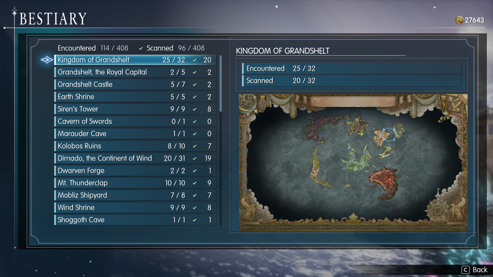
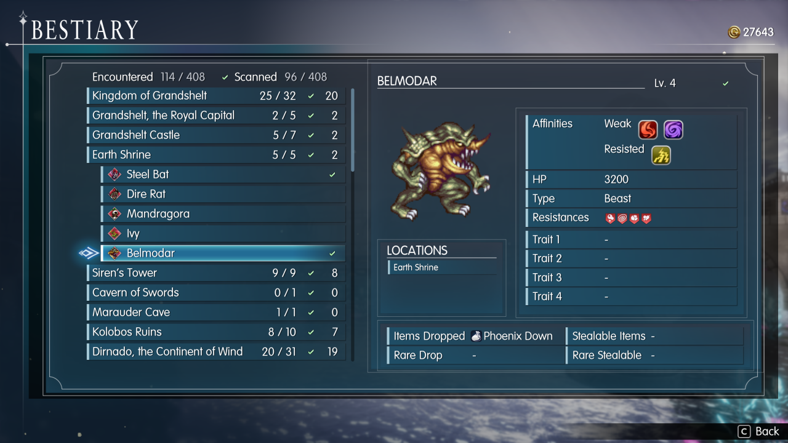

# FFR Bestiary

A bestiary for **FINAL FANTASY RESONANCE** (Steam, PC). It adds a **Bestiary** page to the main menu: every enemy
you have met, grouped by area, with the game's own scan (Libra) details once you have scanned it, its animated
battle sprite, and where it can be found.

> First release, made for community feedback - expect rough edges. Bug reports and suggestions are very welcome in
> [Issues](../../issues).

## Features
- Enemies grouped by area, with encountered / scanned counts for each area and for the whole game
- Unmet enemies of areas you have visited show as `???`, so you can see what is left to find
- Full scan details once scanned: affinities, HP, type, resistances, traits, drops and steals (before a scan, only
  what the battle screen has already shown you)
- Animated battle sprites and the battle timeline's face icons
- Encounter locations: places you have met the enemy are named, the rest show `???`
- Enemies with several forms or phases: confirm on the enemy steps through them
- Installing part-way through the game picks up what your save already records (enemies defeated or scanned, areas
  visited)
- Works with controller and keyboard; uses the game's own fonts, panels and icons

## Install
Download from [Nexus Mods](https://www.nexusmods.com/finalfantasyresonance/mods/88) or [Releases](../../releases)
(`FFRBestiary.zip`), unzip it anywhere, and follow `README.txt` inside:

1. Close the game. Double-click `Install.bat`.
2. Start the game from Steam, wait for the title screen, quit.
3. Double-click `Install.bat` again (needs an internet connection the first time).

Run `Install.bat` again after a game update. `Uninstall.bat` removes everything and keeps your bestiary progress in
`%LOCALAPPDATA%\FFRS-backups`.

**Your game saves are never written.** The installer backs them up first anyway. Bestiary progress lives in its own
files next to the mod (one per save slot).

**Antivirus:** one or two scanners may flag the download. That is UE4SS's loader (`dwmapi.dll`), which works by
loading into the game process - the usual false positive for UE4SS mods. All the mod's own code is the Lua and
PowerShell in this repo.

## How it works
- A [UE4SS](https://github.com/UE4SS-RE/RE-UE4SS) Lua mod (`runtime/FFRBestiary`) builds the page inside the game's
  own menu, tracks the enemies you meet in battle, and reads scan status from your save.
- The menu entry needs two rows in the game's data tables. **No game files are distributed**: the installer extracts
  those two tables from your own install with [retoc](https://github.com/trumank/retoc), adds the rows with
  `tools/uasset-json` (built on [UAssetAPI](https://github.com/atenfyr/UAssetAPI)), and packs a small `~mods` pak on
  your PC. It first runs the game once with a helper mod that writes the property mappings these tools need.
- `data/bestiary_data.*` holds IDs, numbers and string-table keys only; all names and text come from the game at
  runtime, in your game's language.

## Building from source
Developer notes are in [docs/NOTES.md](docs/NOTES.md) and the original design in [docs/SPEC.md](docs/SPEC.md).
The data tools need the game's files extracted locally (`tools/ffr-dump`, a CUE4Parse dumper; a `.usmap` from
UE4SS) - nothing extracted is committed. `tools/make_release.sh` assembles the release zip.

## Credits and licence
- Mod code: MIT licence ([LICENSE](LICENSE)).
- Bundled third-party tools (MIT): UE4SS, retoc, UAssetAPI (compiled into `uasset-json`).
- The data tools use [CUE4Parse](https://github.com/FabianFG/CUE4Parse); recon was helped by the open-source
  FFR Vision Studio project.

FINAL FANTASY RESONANCE is © SQUARE ENIX. This is an unofficial fan mod, not affiliated with or endorsed by
Square Enix.
